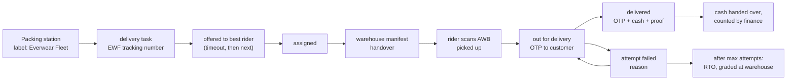

# Own delivery fleet

Last updated: 2026-11-05. Phase 3 of the logistics programme. Builds on the
warehouse fulfilment in [FULFILMENT.md](./FULFILMENT.md).

Our own riders deliver parcels in delivery zones around a warehouse.
Parcels outside the zones still go by courier. Shiprocket's couriers manage
their own executives; nothing here touches them.

## Pieces

| Piece | Where |
| --- | --- |
| Zones (warehouse, PIN codes, whether COD is collected) | `delivery_zones`, `/admin/delivery-zones` |
| Riders (account, documents, vehicle, hub, zones, shifts, online, last position) | `riders`, `/rider/*` for themselves, `/admin/riders` |
| Delivery tasks (one per own-fleet parcel) | `delivery_tasks`, `lib/fleet/tasks.ts` |
| Offers, assignment, route order, background sweep | `lib/fleet/dispatch.ts` |
| OTP encryption, shifts, route ordering, settings | `lib/fleet/support.ts` |
| Cash remittances and reconciliation | `cod_remittances`, `lib/fleet/cod.ts` |
| Undelivered parcels back at the warehouse (own fleet and courier) | `lib/fleet/rto.ts`, `/warehouse/rto/:awb` |
| Rider app | `apps/rider` (port 7201) |
| Customer view (OTP, rider, position) | `GET /store/orders/:id` `delivery`, storefront tracking page card |

## Booking

At the warehouse label step, `ownFleet: true` books the parcel on our fleet
when the destination PIN code is in an active zone of that warehouse. COD
parcels also need a zone that collects cash. A booking creates:

- a shipment (`provider: "own_fleet"`, carrier "Everwear Fleet", AWB
  `EWF` plus a sequence from the `own_fleet_awb` counter). Customers track it
  like any other shipment;
- a delivery task holding the doorstep details and any cash due. The cash
  due is the order total, copied from the order and never set by the rider.

The warehouse prints our own label (`GET
/warehouse/fulfilments/:id/own-label`, available only from booking until
dispatch; it carries the address, as a courier label does), puts the parcel
on an "Everwear Fleet" manifest and hands it over at the dock.

## Dispatch

A new task is offered at once to the best eligible rider. Eligible means
approved, online, on shift (India time; overnight shifts supported; no shifts
set means any time online), covering the zone, under `maxActiveTasks`, and
not having declined it. Ranking:

1. riders already carrying parcels to the same PIN code (batching);
2. then the fewest active tasks;
3. then whoever has been online longest.

The rider has `offerTimeoutMinutes` to accept. A decline or a lapse puts the
task back in the pool and offers it to the next rider. The sweep (every 30
seconds in the API process) lapses unanswered offers and offers waiting
tasks. Going online also offers waiting tasks in the rider's zones.

Admins can assign a task to any approved rider covering its zone, unassign
it, or trigger an offer. Each of these is audited.

**Route order:** when the warehouse and every stop have coordinates, stops
are ordered by nearest neighbour from the warehouse. Otherwise they're
grouped by PIN code, nearest PIN to the warehouse first. Storefront addresses
carry no coordinates today; geocoding would need a maps provider.

## At the door

- **Pickup:** the rider scans the AWB at the dock. It must be their task,
  and the warehouse must already have handed it over on a manifest.
- **Out for delivery:** each parcel gets a fresh 6-digit OTP, stored
  encrypted (AES-256-GCM, key derived from `JWT_SECRET`). The customer sees
  it on their order page; the rider never receives it. The customer's phone
  number is shown to the rider only from now on.
- **Delivered:** requires the right OTP. After 5 wrong tries the rider must
  issue a new one. For COD, the rider must confirm collecting exactly the
  amount due; any other amount is refused. Proof of delivery records the
  time, rider, receiver's name, position (if the rider's device allows it),
  and an optional photo. Photos must be JPEG, PNG or WebP (checked by their
  bytes), are stored in `PRIVATE_UPLOADS_DIR`, and are served only to admins.
- **Failed attempt:** a reason from a fixed list, a note, an optional
  reschedule time and the position. After `maxAttempts` the parcel goes to
  RTO. An admin can also start RTO early.
- **RTO:** the warehouse scans the returned parcel and grades each unit
  sellable or damaged. Stock moves through the ledger. An unpaid COD order is
  cancelled; a prepaid one is left for the admin to refund. The same screen
  handles courier RTOs.

## Location

The rider app shares the device position only while the rider is online
with a parcel out for delivery. The API refuses positions at any other time.
Only the latest position is kept, and going offline clears it. A customer
sees it only for their own order, only while it's out for delivery, and only
when it's under 10 minutes old.

## Cash on delivery

A rider's cash in hand is everything they've collected and not handed over.
Handing over creates a remittance covering exactly those parcels, with the
amount the rider says they're handing over. Finance (or the owner) enters
the counted amount:

- An exact match reconciles it: those COD orders become paid, recorded as
  payment events, and delivered ones are completed.
- Any difference is flagged as a mismatch, and nothing is marked paid until
  a recount matches.

The cash count is what verifies a COD payment. Delivery alone never marks an
order paid.

## Earnings

Each delivery books `payoutPerDelivery`, and each failed attempt books
`payoutPerFailedAttempt`, on the task at that moment. Changing the rates
later doesn't rewrite past earnings. **The defaults (₹40 per delivery, ₹15
per attempt) are placeholders**; set the real rate card with `PATCH
/admin/fleet/settings` (owner only).

## State machines

| Machine | Moves |
| --- | --- |
| delivery | unassigned -> offered -> assigned -> picked_up -> out_for_delivery -> delivered. offered -> unassigned (decline or lapse); assigned -> unassigned (admin); out_for_delivery -> attempt_failed -> out_for_delivery or rto; picked_up -> rto; rto -> returned; cancelled from unassigned, offered or assigned |
| cod | submitted -> reconciled or mismatch; mismatch -> mismatch or reconciled |

The shipment follows the delivery task:

| Delivery task | Shipment |
| --- | --- |
| picked_up | picked_up |
| out_for_delivery | out_for_delivery |
| attempt_failed | delivery_failed |
| delivered | delivered |
| rto | rto_initiated |
| returned | rto_delivered |

These moves use the existing forward-only rule, so the order and the
tracking page update exactly as for a courier.

## Access

| Who | Sees |
| --- | --- |
| Rider, offered | Locality, PIN code, cash due |
| Rider, assigned | Plus name, address and instructions |
| Rider, out for delivery | Plus the customer's phone |
| Rider, after delivery | No address |
| Rider | Document numbers masked to the last 4 digits; only their own tasks (others answer 404) |
| Admin | Full documents (for verification), all tasks without the OTP, proof photos |
| Customer | Their own order's OTP, rider first name and position, as above |

Riders must be approved by an admin (store_admin, order_manager or owner)
after their driving licence and Aadhaar are verified (bicycles excepted) and
they have a hub and zone. A suspended rider is taken offline and loses access
on their next request. Registration and login are rate-limited in the API and
at the edge proxy.

## API

**Rider (`/rider`, CORS `RIDER_CORS`, token audience `everwear:rider`, 12 hours):**

- Account and profile:
  - `POST /auth/register`, `POST /auth/login`
  - `GET /me`, `PATCH /me` (name, vehicle, shifts)
  - `PUT /me/documents/:type`
  - `POST /me/availability`, `POST /me/location`
- Deliveries:
  - `GET /tasks` (offers and route), `GET /tasks/:id`
  - `POST /tasks/:id/accept`, `POST /tasks/:id/decline`
  - `POST /pickup`, `POST /tasks/start`
  - `POST /tasks/:id/otp` (issues a new OTP)
  - `POST /tasks/:id/deliver` (multipart, optional photo)
  - `POST /tasks/:id/fail`
- History and money:
  - `GET /history`, `GET /earnings`
  - `GET /cash`, `POST /cash/remit`

**Admin (`/admin`):**

- Settings: `GET/PATCH /fleet/settings`
- Zones: `GET/POST /delivery-zones`, `PATCH /delivery-zones/:id`
- Riders:
  - `GET /riders`, `GET /riders/:id` (30-day stats, cash in hand)
  - `POST /riders/:id/status`
  - `POST /riders/:id/documents/:type/verify`
  - `PATCH /riders/:id/assignment`
- Deliveries:
  - `GET /delivery-tasks`, `GET /delivery-tasks/:id`
  - `POST /delivery-tasks/:id/assign`, `/unassign`, `/offer`, `/rto`
  - `GET /delivery-tasks/:id/pod-photo`
- Cash: `GET /cod-remittances`, `POST /cod-remittances/:id/reconcile` (finance_manager or owner)

**Warehouse app:** at the label step, parcels whose destination is in a zone
(and, for COD, a zone that collects cash) offer "Everwear Fleet" as well as
"Courier", with our riders as the default. "Print Everwear Fleet label"
fetches the address only to print it. The Returns screen recognises an
undelivered parcel by its outbound AWB and grades it back into stock.

**Warehouse (`/warehouse`) additions:**

- `ownFleet` on `POST /fulfilments/:id/label`
- `ownFleet` (zone availability) on `GET /fulfilments/:id`
- `GET /fulfilments/:id/own-label`
- `GET /rto/:awb`, `POST /rto/:awb/receive`

## Indexes

| Collection | Indexes |
| --- | --- |
| `delivery_zones` | `code` unique; `{warehouseId, pincodes, active}` |
| `riders` | `email` unique; `phone` unique; `{status, online, zoneIds}` |
| `delivery_tasks` | `code` unique; `shipmentId` unique (one task per parcel); `{riderId, status}`; `{status, zoneId, createdAt}`; `offer.expiresAt`; `orderId` |
| `cod_remittances` | `code` unique; `{riderId, submittedAt}`; `status` |

## Configuration

| Variable | Purpose |
| --- | --- |
| `RIDER_CORS` | Rider app origins (`http://localhost:7201` in development) |
| `PRIVATE_UPLOADS_DIR` | Proof-of-delivery photos. Never served under `/uploads`. Persisted in production through the `backend_private_uploads` volume. |
| `VITE_API_URL` (apps/rider) | API base URL baked into the rider app build |

Production: `apps/rider/Dockerfile`, the `rider` compose service, and
`rider.everwear.com` behind the edge proxy. The proxy allows camera and
location on that origin only. The TLS certificate must cover
`rider.everwear.com`.

## Tests

- `apps/backend/test/fleet.test.ts` (21 tests, no courier integration):
  - onboarding and approval rules;
  - outside-zone refusal;
  - booking and offer;
  - what riders see at each stage;
  - pickup only after handover;
  - OTP shown to the customer and never to the rider, and not stored in clear;
  - wrong-OTP and wrong-cash refusals;
  - multipart proof photo, private and admin-only;
  - short and exact cash counts;
  - decline, lapse and manual assignment;
  - three failed attempts to RTO, then graded back into stock with the COD
    order cancelled;
  - earnings;
  - token separation and suspension;
  - route order and India-time shifts.
- `apps/rider/e2e` (6 tests, Chrome at phone size, real API):
  - going online brings offers;
  - accept, then hub pickup with a wrong AWB refused;
  - out for delivery with real location shared and visible to the customer;
  - OTP and cash delivery;
  - failed attempt;
  - cash handover and earnings;
  - sign-up held as pending.

  axe accessibility checks run throughout.

## Not done yet

- **Admin screens:** zones, riders, the delivery board and cash
  reconciliation are API-only so far; their screens come with the admin work.
- **Customer notifications:** customers learn their OTP from the order page.
  SMS, WhatsApp and push arrive with the notification phase, which will send
  it as well.
- **Maps:** no geocoding of addresses and no traffic-aware routing; both need
  a maps provider.
- **Live map:** the customer gets a link to the rider's last position, not an
  embedded live map.
- **Payments to riders:** earnings are recorded but not paid out; payouts
  need a payout provider or the finance process.
