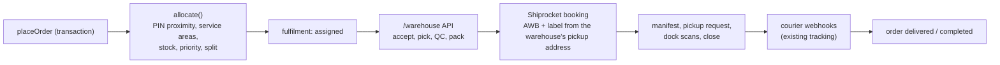

# Warehouse fulfilment (WMS)

Last updated: 2026-11-05. Phase 1 of the logistics programme: backend only.

## What it does

An order whose items are stocked in warehouses is allocated to the best
warehouse at checkout, with its units reserved in the same transaction. Warehouse
staff then accept, pick, inspect, pack, label, manifest and hand it to the
courier. Every unit that moves writes one stock-ledger row, and every status
change writes one status event.

## Opting in, and legacy behaviour

A variant is warehouse-managed once it has a **stock level** (a row in
`stock_levels`). This happens when a warehouse receives it, or through
`POST /admin/stock-levels/opening-balance`, which books its current sellable
count into one warehouse.

- An order with **no** warehouse-managed lines creates no fulfilment. It ships
  as before, from the order page (`POST /admin/orders/:id/shipments`).
- An order with **any** warehouse-managed line is allocated. The order page
  then refuses a direct booking (`warehouse_fulfilment`), so the
  pick/QC/pack checks can't be bypassed. Unmanaged lines ride along in the
  first parcel, unreserved.

The product variant's `stock` (what the storefront sells against) always
equals the sum of `available` across warehouses for managed variants. The
product page and the old `/admin/inventory/adjust` refuse to set it for those
(`warehouse_managed`).

## Stock model

Buckets per variant per warehouse: `available` (the only sellable one),
`reserved`, `picked`, `packed`, `damaged` and `quarantine`, plus running
`receivedTotal` and `dispatchedTotal`.

| Event | Move |
| --- | --- |
| Receive goods / opening balance / transfer in | outside -> available |
| Order allocated | available -> reserved |
| Pick scan | reserved -> picked |
| Failed QC | picked -> damaged, then available -> reserved for a replacement |
| Pack | picked -> packed |
| Manifest closed | packed -> outside (dispatch) |
| Cancel / decline / reassign | reserved, picked or packed -> available |
| Return inspected | outside -> quarantine -> available (sellable) or damaged |
| Damage found on shelf / write-off / count correction | available -> damaged / damaged -> outside / +-available |

`lib/inventory/stock.ts#moveStock` is the only writer. Its guarded `$inc`
refuses to take any bucket below zero, and it writes the ledger row in the
caller's transaction. A transfer is immediate. There's no in-transit stock
between warehouses yet.

## Allocation

`lib/fulfilment/allocate.ts`, inside the order transaction:

1. Eligible warehouses: active, `acceptsOrders !== false`, `serviceAreas`
   empty or containing a prefix of the delivery PIN code, and not one that
   already declined this order.
2. Ranked by the length of the shared PIN-code prefix (the Indian PIN
   hierarchy: zone, then circle, then sorting district), then `priority`
   (lower first), then code.
3. The first warehouse holding everything wins. Otherwise, if
   `settings.allowSplitFulfilment !== false`, warehouses are taken in turn by
   how many of the remaining units each can cover.
4. If nothing can fill the order, it fails with `out_of_stock` or
   `unserviceable`, and the whole placement rolls back.

Courier rates are compared when the parcel is booked from the chosen
warehouse, not during allocation, because a network call can't sit inside
the order transaction.

Duplicate tasks are impossible: a partial unique index allows one live
fulfilment per order and warehouse.

## State machines

`lib/state/machines.ts`. Each machine has its own field and its own table of
legal moves. An illegal move or a repeat move answers 409 `invalid_transition`
(or `stale` when a concurrent request won). Every move is appended to
`status_events` with the actor (system, admin, warehouse, customer or
courier) and a reason.

| Machine | Field | Moves |
| --- | --- | --- |
| order | `orders.status` | pending -> completed, canceled |
| payment | `orders.paymentStatus` | awaiting -> paid -> partially_refunded / refunded |
| fulfilment | `fulfilments.status` | assigned -> picking_pending -> picking -> picked -> qc_passed -> packed -> label_generated -> ready_to_dispatch -> manifested -> handed_over -> dispatched. Also: assigned -> rejected; picked -> picking_pending (failed QC); label_generated / ready_to_dispatch -> packed (courier booking cancelled); manifested -> ready_to_dispatch (not handed over); cancel allowed until packed. |
| shipment | `shipments.status` | ranked courier statuses (`lib/shipping/status.ts`), unchanged |
| return | `orders.returnRequest.status` | requested -> approved -> pickup_scheduled -> received -> inspected -> refunded; requested / approved -> rejected -> approved |

Status events are recorded today for: order placement, cancellation and
completion; the payment status at placement; every fulfilment move; and
every return move. Payment moves made later by refunds and settlement don't
write status events yet.

## Scan validation

| Step | Must scan | Refused with |
| --- | --- | --- |
| Pick | the SKU of a line still to pick | `wrong_item` (another size, colour or product), `over_pick` |
| Pack | the pick slip (`FUL-<order>-<n>`) and every unit going in the box | `wrong_order`, `wrong_item`, `over_pack`, `missing_item` |
| Label | the parcel barcode (`PKG-...`) | `wrong_package` |
| Ready to dispatch | the AWB on the applied label | `wrong_awb` |
| Handover | each AWB on the manifest | `not_on_manifest`, `already_scanned` |

Scan errors are 422 and move nothing.

## Warehouse API (`/warehouse`, CORS `WAREHOUSE_CORS`)

Staff accounts (`warehouse_users`) are separate from admin accounts. They use
the token audience `everwear:warehouse` (12 hours), are reloaded on every
request (so a suspension takes effect at once), and are scoped to
`warehouseIds`. Another warehouse's records answer 404. Responses never carry
the customer's name, phone, email or street. A fulfilment holds only city,
state and PIN code.

| Role | Permissions |
| --- | --- |
| picker | view, pick |
| packer | view, qc, pack, label |
| inspector | view, qc (including returns) |
| dispatcher | view, accept, label, dispatch |
| supervisor | all of the above, plus stock |

| Method and path | Purpose |
| --- | --- |
| `POST /auth/login` | Sign in (rate-limited) |
| `GET /me` | User, permissions, warehouses |
| `GET /fulfilments?warehouseId&status&limit` | Queue, oldest first |
| `GET /fulfilments/:id` | Detail with status history |
| `GET /scan/fulfilment/:code` | Look up by scanned pick slip |
| `POST /fulfilments/:id/accept`, `/reject {reason}` | Accept. Reject releases stock and re-allocates. |
| `POST /fulfilments/:id/picking/start`, `/picking/scan {barcode, quantity}`, `/picking/complete` | Picking |
| `POST /fulfilments/:id/qc {result, notes?, failures?}` | Quality check |
| `POST /fulfilments/:id/pack {orderCode, scans[], weightKg, lengthCm, breadthCm, heightCm}` | Packing |
| `POST /fulfilments/:id/label {packageCode, courierId?, manual?}` | Courier booking, AWB and label (retry-safe) |
| `POST /fulfilments/:id/label/verify {awb}` | Label applied to the right box |
| `GET/POST /manifests`, `POST /manifests/:id/scan {awb}`, `POST /manifests/:id/close {courierExecutive}` | Manifest and handover |
| `GET /stock?warehouseId&sku`, `GET /stock/ledger?warehouseId&variantId` | SKU lookup, ledger |
| `POST /stock/operations` | `receive`, `adjust`, `damage`, `write_off`, `transfer` |
| `PATCH /stock/:id/bin {binCode}` | Rack/bin placement shown on pick lines |
| `GET /returns/lookup?awb|orderNumber`, `POST /returns/:orderId/inspect` | Return receipt and inspection |

## Admin API additions (`/admin`)

| Method and path | Who |
| --- | --- |
| `GET/POST /warehouse-users`, `PATCH /warehouse-users/:id` | read: owner, store_admin, inventory_manager; write: owner, store_admin |
| `GET /fulfilments?warehouseId&status&orderId&page&limit` (with counts by status), `GET /fulfilments/:id` (with history and ledger) | any admin |
| `POST /fulfilments/:id/reassign {warehouseId, reason}` | owner, store_admin, order_manager, inventory_manager; audited |
| `POST /orders/:id/allocate {warehouseId?}` | same; audited |
| `GET /orders/:id/history` | any admin |
| `GET /stock-levels`, `GET /stock-ledger` | any admin |
| `POST /stock-operations`, `POST /stock-levels/opening-balance` | owner, store_admin, inventory_manager; audited |
| `PATCH /warehouses/:id` | now also takes `serviceAreas`, `priority`, `acceptsOrders`, `shiprocketPickupLocation` |

## Collections and indexes

| Collection | Indexes |
| --- | --- |
| `stock_levels` | `{variantId, warehouseId}` unique; `{warehouseId, sku}` |
| `stock_ledger` (append-only) | `{warehouseId, createdAt}`, `{variantId, createdAt}`, `{ref.id}` |
| `fulfilments` | `{orderId, warehouseId}` unique where `active`; `{code}` unique; `{warehouseId, status, createdAt}`; `{awb}` sparse |
| `manifests` | `{code}` unique; `{warehouseId, status}` |
| `warehouse_users` | `{email}` unique |
| `status_events` (append-only) | `{entityId, at}`, `{orderId, at}` |
| `shipments` | `one_live_parcel_per_order` replaced by `one_live_parcel_per_fulfilment` `{orderId, isReturn, fulfilmentId}` (dropped and recreated on start) |

Retention: the ledger and status events are permanent business records. No
TTL is applied.

## Configuration

| Variable | Purpose |
| --- | --- |
| `WAREHOUSE_CORS` | Browser origins of the warehouse app (planned `apps/warehouse`, port 7101) |
| Warehouse `shiprocketPickupLocation` | That building's pickup nickname on Shiprocket. Without it, bookings fall back to `SHIPROCKET_PICKUP_LOCATION`. Each must be created on the Shiprocket dashboard first. |

## Tests

`apps/backend/test/fulfilment.test.ts` (26 tests, against the provider stub)
covers:

- receiving and the ledger;
- cross-warehouse and role refusals;
- below-zero adjustments;
- the product-page overwrite guard;
- opening balance;
- prepaid order -> nearest warehouse -> wrong-size pick refused -> QC -> pack scan checks -> Shiprocket AWB and label from the warehouse pickup address -> manifest and dock scans -> dispatch -> courier webhook delivery, with duplicate webhook ignored -> completed;
- return -> approval -> inspection restock -> refund;
- COD order from Delhi staying open until cash is settled;
- split fulfilment;
- rollback when split is off;
- six concurrent checkouts for one unit;
- decline and re-allocate;
- audited reassignment;
- cancel releasing stock exactly once;
- failed QC write-off and replacement;
- token audiences, suspension and login.

## Not in Phase 1

Each later phase builds on the models here:

- **Phase 2:** the `apps/warehouse` UI (scanner-first, mobile) on this API.
  Warehouse users currently see only the API.
- **Phase 3:** own delivery fleet. Riders, zones, route grouping, assignment
  and acceptance, OTP and proof of delivery, COD collection and the COD
  reconciliation machine, and `apps/rider`.
- **Phase 4:** reverse logistics UI and exchanges. The refund machine as a
  first-class record, and storefront return tracking.
- **Phase 5:** notifications. Email, SMS, WhatsApp and push through
  providers, driven by `outbox_events` (`order.placed` and
  `fulfilment.assigned` are emitted today). The outbox worker currently only
  marks events published and sends nothing.
- **Phase 6:** seller marketplace (`apps/seller`): KYC, seller-fulfilled
  orders, commissions and settlements.
- **Phase 7:** a direct Delhivery adapter behind the same shipping interface,
  logistics analytics dashboards, and admin UI for all of the above.
