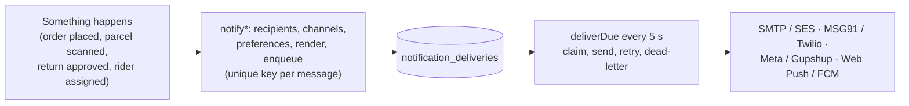

# Notifications

Last updated: 2026-11-05. Phase 5 of the logistics programme.

## How it works



- **Producers:**
  - Events raised inside a database transaction go through the transactional
    outbox (`order.placed`, `fulfilment.assigned`, `delivery.offered`), so a
    message is never sent for a change that rolled back.
  - Everything else is enqueued just after the change commits, wrapped in
    `announce()`. A notification failure never breaks the business action.
- **One message per recipient and channel.** The key is
  `<event key>:<channel>:<recipient>`, and a unique index means a repeated
  webhook, scan or retry never sends twice.
- **Worker:** claims a message (with a 2-minute lease, so several API
  processes never double-send), sends it, and records the provider's message
  id. Failures are classified:
  - unknown outcome, 5xx or 429: retried after 1, 5, 30, 120 and 360
    minutes;
  - other 4xx (bad number, refused address): permanent.

  After 5 attempts, or on a permanent failure, the message is `dead` (dead
  letter) and an owner can retry it. A crashed process's lease expires and
  the message is picked up again, so delivery is at least once.
- **Skipped (not failed):**
  - the channel has no provider configured;
  - the event has no provider template (MSG91 flow, WhatsApp template);
  - the recipient has no push device;
  - a delivery code is no longer valid.
- **Retention:** sent and skipped messages are kept for 180 days (TTL index);
  dead letters stay until handled.
- **In-app feed:** customers also get a feed entry for each event, shown on
  Account > Notifications. Order confirmation and return updates write their
  own entries.

## Channels and providers

| Channel | Providers | Notes |
| --- | --- | --- |
| Email | SMTP (nodemailer), Amazon SES v2 (SigV4-signed HTTPS) | HTML and text. SES signing is unit-checked against AWS's published SigV4 example. |
| SMS | MSG91 Flow API, Twilio | MSG91 sends a DLT-approved flow with variables `var1`, `var2`, ... Twilio sends the plain text (Indian numbers still need DLT registration of sender and content). |
| WhatsApp | Meta Cloud API, Gupshup | Approved templates only; body parameters in order. Customers must opt in. |
| Push | Web Push (VAPID; payload encrypted with RFC 8291 by `web-push`), FCM HTTP v1 (service-account OAuth) | Storefront, rider app and warehouse app register through `/sw.js`. FCM is for future native apps (register a token at `/…/push-subscriptions` with `{ token }`). |

Which provider: `NOTIFY_EMAIL_PROVIDER`, `NOTIFY_SMS_PROVIDER` and
`NOTIFY_WHATSAPP_PROVIDER`, else the first one configured.
`GET /admin/notifications/status` shows what can send right now.

## Events, recipients and channels

| Event | Who | Channels | When |
| --- | --- | --- | --- |
| `order_confirmed` | Customer | email, sms, whatsapp, push | Order placed (outbox) |
| `payment_received` | Customer | email, push | COD cash reconciled |
| `order_packed` | Customer | email, push | Warehouse packing done |
| `order_shipped` | Customer | email, sms, whatsapp, push | Courier or rider picked up |
| `out_for_delivery` | Customer | sms, whatsapp, push | Each time it goes out |
| `delivery_otp` | Customer | sms, whatsapp, push | Own fleet: out for delivery, or a new code issued. Push says the code is on the order page; the code is never on a lock screen. |
| `delivered` | Customer | email, sms, whatsapp, push | Delivered |
| `delivery_failed` | Customer | email, sms, whatsapp, push | Each failed attempt |
| `return_update` | Customer | email, whatsapp, push | Requested, approved, pickup booked, received, refund started, refunded, exchange sent, rejected |
| `refund_processed` | Customer | email, sms, whatsapp, push | Each refund processed (once per refund) |
| `fulfilment_assigned` | Warehouse staff of that warehouse | email, push | Order allocated (outbox) |
| `delivery_offered` | The rider offered | sms, push | Offer made (outbox; only if still open) |
| `delivery_assigned` / `delivery_unassigned` | The rider | sms, push / push | Admin assigns or moves a delivery |

**Customer preferences** (`/store/customers/me/notification-preferences`):
email, SMS and push default on; WhatsApp is off until the customer opts in,
and the opt-in time is recorded. These are order and delivery updates only;
nothing is promotional. Guests (no account) get email and SMS from the order.

**The delivery OTP** is stored on the message only as a reference to its
delivery. It's decrypted at the moment of sending and never written in
clear. If the parcel has been delivered or a new code was issued, the queued
message is skipped.

## Template variables (register your templates in this order)

SMS (MSG91 `var1`, `var2`, ...) and WhatsApp body parameters use the same
order:

| Event | Variables |
| --- | --- |
| `order_confirmed` | first name, order number (#1042), total (Rs 1,999.00) |
| `payment_received` | order number, amount |
| `order_packed` | order number |
| `order_shipped` | order number, courier, AWB |
| `out_for_delivery` | order number, rider first name or courier |
| `delivery_otp` | code, order number |
| `delivered` | order number |
| `delivery_failed` | order number, reason |
| `return_update` | return code (RET-1042-1), status |
| `refund_processed` | amount, order number |
| `fulfilment_assigned` | fulfilment code, warehouse code |
| `delivery_offered` | area, cash to collect (or "prepaid") |
| `delivery_assigned`, `delivery_unassigned` | AWB |

The owner sets the provider template per event:

```
PUT /admin/notifications/templates/<event>
{ "msg91FlowId": "...", "whatsapp": { "name": "...", "language": "en" }, "gupshupTemplateId": "..." }
```

The Twilio SMS text and the email and push wording are in
`apps/backend/src/lib/notify/templates.ts`.

## Admin API

| Endpoint | Purpose |
| --- | --- |
| `GET /admin/notifications/status` | Channels that can send; message counts by status; failed outbox events |
| `GET /admin/notifications/deliveries?status&channel&event&orderId` | Messages and their outcome (email bodies left out) |
| `POST /admin/notifications/deliveries/:id/retry` | Owner: retry a dead letter |
| `GET /admin/notifications/templates`, `PUT /admin/notifications/templates/:event` | Provider templates per event (owner, audited) |
| `GET /admin/outbox?status=failed`, `POST /admin/outbox/:id/retry` | Background events that failed 5 times |

## Push devices

The storefront (Account > Notifications), rider app (Profile) and warehouse
app (bell in the header) each:

1. register `/sw.js`;
2. ask the browser's permission;
3. subscribe with the API's VAPID key (`GET …/push/key`);
4. post the subscription (`POST /store/customers/me/push-subscriptions`,
   `/rider/push-subscriptions` or `/warehouse/push-subscriptions`).

Rules:

- A device that moves to another account moves with it.
- An account keeps at most 10 devices.
- A device the push service reports gone (404/410, or FCM `UNREGISTERED`) is
  removed.
- In production only the browsers' push services (Google, Mozilla,
  Microsoft, Apple) are accepted as endpoints, so the API can't be made to
  call arbitrary hosts.

## What needs your accounts

| To turn on | You need |
| --- | --- |
| Email | An SMTP relay login (or SES with a verified domain, out of the SES sandbox) and `MAIL_FROM` on that domain with SPF/DKIM set |
| SMS (India) | DLT registration (entity, sender ID/header, content templates matching the variable order above), then an MSG91 flow per event (or Twilio with DLT-registered sender) |
| WhatsApp | A WhatsApp Business account with Meta (or Gupshup), approved templates per event, and a permanent token |
| Web push | VAPID keys (`npx web-push generate-vapid-keys`); nothing else |
| FCM | A Firebase project and a service-account key; native apps to register tokens |

## Tests

`apps/backend/test/notifications.test.ts` (19 tests) runs against local
stand-ins for every provider (`test/notify-stub.ts`): an SMTP server with
login; SES checking the SigV4 signature; MSG91; Twilio; Meta; Gupshup;
Google OAuth checking the RS256 assertion; FCM; and a web push service that
decrypts the RFC 8291 payload with the browser's keys. It covers:

- opt-in and device registration, and production endpoint checks;
- template admin and roles;
- an order through the outbox to all four channels, with each provider's
  exact request;
- no duplicates;
- courier updates, with skipped channels when templates are missing;
- retries with backoff, permanent refusals, dead letters after five tries,
  and admin retry;
- a refused email address;
- SMS turned off;
- the OTP decrypted only at send time and dropped after delivery;
- Twilio, Gupshup and SES switched in at runtime;
- FCM with token caching, and unregistered tokens removed;
- unsubscribed browsers removed;
- the admin message list.

The rider browser test checks that turning notifications on asks the browser
and reports its real answer. Automated Chrome refuses push registration, and
the app shows that refusal rather than claiming notifications are on.

## Not done yet

- **Delivery receipts:** Twilio status callbacks, Meta webhook statuses and
  SES bounce/complaint notices. A message is "sent" when the provider
  accepted it.
- **Unsubscribe links in emails:** these are transactional messages. A
  `List-Unsubscribe` header would be needed for any future marketing mail.
- **Admin screen:** an admin screen for message logs and templates is part
  of the remaining admin work. Today it's API-only.
