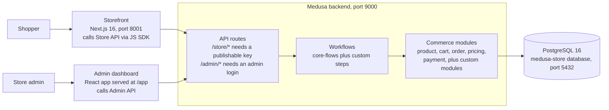

# Everwear — Project Docs

Last updated: 2026-10-29

## Overview

Everwear is a headless e-commerce store: a Medusa 2.22.1 backend with an admin dashboard, plus a Next.js 16 storefront, in one Turborepo monorepo managed with npm.

| Layer | Technology | Version |
| --- | --- | --- |
| Backend + Admin | Medusa (`@medusajs/medusa`) | 2.22.1 |
| Storefront | Next.js (App Router, Turbopack), React | 16.3.8, 19.0.5 |
| Styling | Tailwind CSS, `@medusajs/ui` | 3.x |
| Storefront API client | `@medusajs/js-sdk` | 2.22.1 |
| Database | PostgreSQL (Docker container `medusa-postgres`) | 16 |
| Monorepo | Turborepo, npm workspaces | npm 10.9.7 |
| Runtime | Node.js | 22.22+ |

## Architecture and design

The storefront and admin dashboard are thin clients; all business logic and data live in the Medusa backend.

A request flows top to bottom: an API route validates it, runs a workflow, and the workflow changes data through commerce modules, which store it in Postgres.

**Example: adding to cart**

1. The shopper clicks Add to cart on a product page.
2. A server action in `apps/storefront/src/lib/data/cart.ts` calls `POST /store/carts/:id/line-items` with the publishable key.
3. The backend route runs the core add-to-cart workflow.
4. The cart and pricing modules update the cart and write it to Postgres; the storefront clears its cart cache so the new item shows.

## Project structure

Two apps live under `apps/`; the backend holds all business logic and the storefront only calls its Store API.

| Path | What it holds |
| --- | --- |
| `apps/backend/medusa-config.ts` | Database URL, CORS, JWT and cookie secrets, modules |
| `apps/backend/src/api/` | File-based routes: `store/*`, `admin/*`, plus `middlewares.ts` |
| `apps/backend/src/workflows/` | Business logic as workflows and steps |
| `apps/backend/src/modules/` | Custom data models and services |
| `apps/backend/src/links/` | Links between modules |
| `apps/backend/src/subscribers/`, `jobs/` | Event handlers and scheduled jobs |
| `apps/backend/src/search/` | Product search index definition |
| `apps/backend/src/migration-scripts/` | Initial data seed and region store policies |
| `apps/backend/src/scripts/` | One-off scripts, e.g. `seed-demo-products.ts` |
| `apps/backend/src/admin/` | Admin dashboard widgets, routes, i18n |
| `apps/storefront/src/app/` | Next.js routes, mostly under `[countryCode]/` |
| `apps/storefront/src/lib/data/` | Server-side Medusa API calls: cart, products, orders, customer, payment |
| `apps/storefront/src/modules/` | Feature UI: home, store, products, cart, checkout, account, order, search |

## Setup and running

Start Postgres, then run `npm run dev` from the repo root; both apps come up in about 10 seconds.

1. Start the database: `docker start medusa-postgres`
2. Install dependencies (first time only): `npm install`
3. Run migrations and the initial seed: `cd apps/backend && npx medusa db:migrate`
4. Create an admin user: `npx medusa user -e admin@example.com -p <password>`
5. Start everything: `npm run dev` (or `npm run backend:dev` / `npm run storefront:dev`)
6. Optional demo products: `npx medusa exec ./src/scripts/seed-demo-products.ts`

| Service | URL (dev) |
| --- | --- |
| Storefront | http://localhost:8001 (port 8000 with `npm run start`) |
| Backend API | http://localhost:9000 |
| Admin dashboard | http://localhost:9000/app |
| Health check | http://localhost:9000/health |

**Environment variables** (names only; never commit the values):

| File | Variables |
| --- | --- |
| `apps/backend/.env` | `DATABASE_URL`, `STORE_CORS`, `ADMIN_CORS`, `AUTH_CORS`, `JWT_SECRET`, `COOKIE_SECRET`, `REDIS_URL` (optional) |
| `apps/storefront/.env.local` | `NEXT_PUBLIC_MEDUSA_BACKEND_URL`, `NEXT_PUBLIC_MEDUSA_PUBLISHABLE_KEY`, `NEXT_PUBLIC_DEFAULT_REGION`, `NEXT_PUBLIC_BASE_URL`, `NEXT_PUBLIC_STRIPE_KEY` |

Production: `npm run build`, then `npm run start`.

## Development guide

Put business logic in workflows, expose it through file-based routes, and keep `npm run lint` clean.

- **Routes are file-based:** a store endpoint is `src/api/store/<path>/route.ts` exporting `GET`, `POST`, and so on.
- **Logic goes in workflows:** routes run a workflow; workflows compose steps. Change commerce data through `@medusajs/medusa/core-flows`, not raw service calls.
- **Imports:** use `@medusajs/framework/*` subpaths, never `@medusajs/utils` directly.
- **Custom models:** after editing one, run `npx medusa db:generate <module>`, then `db:migrate`.
- **Code style:** no semicolons, double quotes, 2-space indent, kebab-case files, PascalCase types, camelCase functions, snake_case DB columns.
- **Dependencies:** install inside the app that needs them (`cd apps/backend && npm install <pkg>`), never at the root.
- **Do not edit:** `node_modules/`, `.medusa/`, `.next/`, `.turbo/`, the lockfile, existing migrations.

| Task | Command (from `apps/backend`) |
| --- | --- |
| Lint | `npm run lint` (root: lints all apps) |
| Unit tests | `npm run test:unit` |
| Module integration tests | `npm run test:integration:modules` |
| HTTP integration tests | `npm run test:integration:http` (needs Postgres) |

## Known issues and notes

None of these block the app today; all were seen during the first run.

- **Locales 404:** the storefront calls `/store/locales` and the backend returns 404. Pages still render.
- **No Redis:** the backend uses an in-memory fake Redis and local event bus. Fine for development; set `REDIS_URL` for production.
- **Node version:** the root `package.json` asks for Node 22.23.4 or newer; the machine runs 22.22.2 without errors.
- **Next.js warning:** the `middleware` file convention is deprecated in Next.js 16; migrate to `proxy` with `npx @next/codemod@canary middleware-to-proxy .`
- **Port docs:** `AGENTS.md` lists the storefront on 8000, but `npm run dev` uses 8001.
  