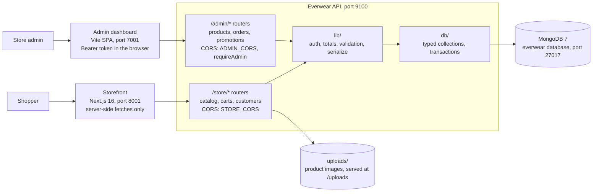

# Everwear — Project Docs

Last updated: 2026-10-29

## Overview

Everwear is a headless e-commerce store: a standalone commerce API with a Next.js storefront and a separate admin dashboard, in one Turborepo monorepo managed with npm.

The API is deliberately independent of any frontend. It speaks plain HTTP and JSON, authenticates with Bearer tokens rather than cookies, and holds all business logic, so the storefront, the admin dashboard and a future mobile app are interchangeable clients.

| Layer | Technology | Version |
| --- | --- | --- |
| API | Node.js, Express, TypeScript, Zod | 22.22+, 5.3, 5.9 |
| Database | MongoDB, single-node replica set `rs0` (Docker container `everwear-mongo`) | 7.0 |
| Storefront | Next.js (App Router, Turbopack), React | 16.4.2, 19.0.5 |
| Admin | React, Vite, React Router, TanStack Query + Table, shadcn/ui `radix-nova`, ReUI | 19.0.5, 8.3 |
| Styling | Tailwind CSS (CSS-first config) | 4.3.3 |
| Icons | lucide-react | latest 0.x |
| Browser tests | Playwright (installed Google Chrome) + axe-core | 1.56 / 4.11 |
| API tests | `node:test` | Node built-in |
| Monorepo | Turborepo, npm workspaces | npm 10.9.7 |

The project started from the Medusa DTC starter and has moved off Medusa entirely. Medusa and PostgreSQL are no longer part of the running stack; the only remaining trace is the one-off `migrate:medusa` script that reads an old Medusa database.

## Architecture and design

The storefront and admin dashboard are thin clients; all business logic and data live in the API.

A request flows top to bottom: Express parses and CORS-checks it, a Zod schema validates it, the route reads or writes through the typed collection accessors, and `lib/serialize.ts` shapes the response.

**Example: adding to cart**

1. The shopper clicks Add to bag on a product page.
2. A server action in `apps/storefront/src/lib/data/` calls `POST /store/carts/:id/items` through the server-only client in `src/lib/api/client.ts`.
3. The route validates the body, looks the variant up in the catalog, and refuses it if the variant is not sold in the cart's currency, is out of stock, or would exceed 10 units on the line.
4. The cart is written with an update conditional on `completedAt: null`, so a cart that was checked out in the meantime cannot be changed.
5. The route re-reads the cart, refreshes every line's price from the catalog, recomputes the totals and returns the cart; the storefront clears its cart cache.

## Project structure

Three apps live under `apps/`. The API holds all business logic; the clients only call it.

| Path | What it holds |
| --- | --- |
| `apps/backend/src/index.ts` | Connects to MongoDB, ensures indexes, starts and shuts down the server |
| `apps/backend/src/app.ts` | Express app: helmet, per-audience CORS, body limits, static uploads, routers, error handler |
| `apps/backend/src/env.ts` | Settings, validated with Zod at startup; the process exits on anything missing or invalid |
| `apps/backend/src/db/client.ts` | `connect`, `getDb`, `withTransaction` |
| `apps/backend/src/db/schema.ts` | Document types, `db.<collection>()` accessors, `ensureIndexes` |
| `apps/backend/src/lib/` | `auth`, `errors`, `validation`, `totals`, `regions`, `serialize`, `ids` |
| `apps/backend/src/routes/store/` | `catalog.ts`, `customers.ts`, `carts.ts` — the shopper-facing API |
| `apps/backend/src/routes/admin/` | `auth.ts`, `products.ts`, `orders.ts`, `store.ts`, `settings.ts`, `users.ts` — the dashboard API |
| `apps/backend/scripts/` | `create-admin`, `migrate-from-medusa`, `localize-catalog` |
| `apps/backend/test/` | `node:test` suites plus `server.ts`, which runs the app on a free port |
| `apps/backend/uploads/` | Uploaded product images, served at `/uploads` with a one-year immutable cache |
| `apps/storefront/src/app/` | Next.js routes, mostly under `[countryCode]/`; `error.tsx`, `global-error.tsx`, `not-found.tsx` boundaries |
| `apps/storefront/src/proxy.ts` | Country-code routing (Next.js 16 name for middleware); falls back to the default region if the API is down |
| `apps/storefront/src/lib/api/` | `client.ts`, the server-only fetch wrapper, and `types.ts`, the API response shapes |
| `apps/storefront/src/lib/data/` | Server-side API calls: cart, products, orders, customer |
| `apps/storefront/src/components/ui/`, `components/reui/` | Installed shadcn and ReUI primitives (do not restyle these files; theme through tokens) |
| `apps/storefront/src/components/store/` | Brand parts: wordmark, container, product card, money format, status page |
| `apps/storefront/src/modules/shell/` | Header, announcement bar, mobile menu, search dialog, cart drawer, region and language pickers, footer |
| `apps/storefront/src/modules/home/`, `catalog/`, `product/`, `bag/` | Home page, listings and filters, product page, cart |
| `apps/storefront/src/modules/checkout/`, `account/`, `order/` | Checkout steps, account and order screens |
| `apps/storefront/src/styles/globals.css` | Brand tokens |
| `apps/storefront/e2e/` | Playwright tests: shopping, checkout, account, mobile, accessibility |
| `apps/admin/src/routes/` | Admin pages: login, dashboard, orders, products, customers, each list's detail page, catalog, promotions, users and settings, plus `module-placeholder.tsx` for the modules still to be built |
| `apps/admin/src/lib/api.ts`, `types.ts` | Admin API client (Bearer token) and the API response shapes |
| `apps/admin/src/components/resource-grid.tsx` | Searchable, filterable, server-paged table shared by the list pages |
| `.claude/skills/reui/` | ReUI design rules for Claude Code |

## Setup and running

Start MongoDB, then run `npm run dev` from the repo root.

1. Start the database: `docker start everwear-mongo`
2. Install dependencies (first time only): `npm install`
3. Create the API environment: `cp apps/backend/.env.template apps/backend/.env`, then set `JWT_SECRET` to 32+ random characters
4. Create an admin user: `cd apps/backend && npm run admin:create -- admin@example.com '<password>' "Your Name"`
5. Create the storefront environment: `cp apps/storefront/.env.template apps/storefront/.env.local`
6. Start everything: `npm run dev` (or `npm run backend:dev` / `npm run storefront:dev`)

| Service | URL (dev) |
| --- | --- |
| Storefront | http://localhost:8001 (port 8000 with `npm run start`) |
| API | http://localhost:9100 |
| Admin dashboard | http://localhost:7001 |
| Health check | http://localhost:9100/health |

MongoDB must be a replica set. Order placement uses a multi-document transaction, which standalone MongoDB rejects.

**Environment variables** (names only; never commit the values):

| File | Variables |
| --- | --- |
| `apps/backend/.env` | `PORT`, `MONGODB_URI`, `MONGODB_DB`, `JWT_SECRET`, `STORE_CORS`, `ADMIN_CORS`, `API_PUBLIC_URL`, `UPLOADS_DIR` |
| `apps/storefront/.env.local` | `EVERWEAR_API_URL`, `NEXT_PUBLIC_API_PUBLIC_URL`, `NEXT_PUBLIC_DEFAULT_REGION`, `NEXT_PUBLIC_BASE_URL` |
| `apps/admin/.env.local` | `EVERWEAR_API_URL` |

Production: `npm run build`, then `npm run start`. The storefront build prerenders the sitemap from the API, so the API must be running.

## API design

| Decision | Why |
| --- | --- |
| Express 5 with async route handlers | A rejected promise reaches the error handler on its own, so routes `throw` and never pass errors along by hand |
| Bearer JWTs, no sessions or cookies | The same endpoints serve a browser and a native mobile app; nothing to replicate between instances |
| Zod at the edge of every route | One validation style, and a `ZodError` becomes a 400 with field details automatically |
| One error envelope, `{ error: { code, message } }` | Clients switch on a stable `code`; unknown errors are logged and flattened to a generic 500 |
| Integer minor units for all money | No float rounding anywhere in cart, promotion or tax maths |
| Cart lines re-priced from the catalog on every read | A client can never hold a stale or tampered price through to an order |
| `withTransaction` for order placement and cancellation | Stock, promotion counters, the order and the cart all move together or not at all |
| Conditional updates (`completedAt: null`, `updatedAt` match) | Two concurrent writers cannot silently overwrite each other |
| Split CORS per audience | A compromised shop origin still cannot reach `/admin` |
| scrypt with a per-user salt, constant-time compare | Password checks give nothing away through timing, including for unknown accounts |

Token lifetimes: customers 7 days, admins 12 hours. Login routes are rate-limited per address and email.

## Design system

Two systems, one per audience. **The storefront** is editorial: warm ivory surfaces, ink text, one cobalt accent, a display serif for headlines and square controls (`radix-sera`). **The admin** is operational: zinc neutrals, royal violet for anything interactive, Inter throughout, 6px controls inside 8px panels (`radix-nova`). They are deliberately different, so a token or a component shape changed in one does not belong in the other.

| Token | Value | Use |
| --- | --- | --- |
| `--background` | `#f6f3ec` ivory | Page |
| `--card` | `#fbfaf6` paper | Panels, footer |
| `--foreground` | `#16171b` ink | Text |
| `--muted-foreground` | `#5e5c57` | Secondary text (6.0:1 on ivory) |
| `--primary` | `#2440d6` cobalt | Main buttons, links, focus ring only |
| `--border` | `#e3ded3` | Hairlines |
| `--destructive-foreground`, `--success-foreground`, `--warning-foreground` | `#8f1d14`, `#14532f`, `#7a4a00` | Status text |

The admin's own palette, in `apps/admin/src/styles/globals.css`:

| Token | Light | Dark | Use |
| --- | --- | --- | --- |
| `--background` | `#fafafa` | `#09090b` | Canvas |
| `--card` | `#ffffff` | `#18181b` | Cards, frames, grids, the nav |
| `--foreground` | `#09090b` | `#fafafa` | Text |
| `--muted-foreground` | `#71717a` | `#a1a1aa` | Secondary text (4.8:1 light, 7.0:1 dark) |
| `--primary` | `#6d28d9` | `#7c3aed` | Buttons, the current nav item, focus ring, chart 1 |
| `--border` | `#e4e4e7` | `#27272a` | Hairlines |
| `--success`, `--warning`, `--destructive`, `--info` | `#059669`, `#d97706`, `#e11d48`, `#2563eb` | `#10b981`, `#f59e0b`, `#f43f5e`, `#3b82f6` | Status tints; the `-foreground` rung is the text tone |

- **Type:** the storefront pairs Fraunces (display serif) with Inter Tight, self-hosted at build time with `next/font`. The admin is Inter alone, from `@fontsource-variable/inter`, with two shared treatments in `apps/admin/src/lib/typography.ts`: `LABEL_CAPS` (11px, semibold, uppercase, `+0.06em`) for micro-labels, table headers and nav groups, and `METRIC_STAT` (28px) for a KPI number. They are Tailwind utilities rather than custom CSS so they merge correctly over a primitive's own classes.
- **Shape:** the storefront is square (`--radius: 0`, `radix-sera` gives uppercase buttons) and its product images are 4:5. The admin sets `--radius: 0.375rem`, so controls land on 6px and cards and grids on 8px (`--radius-xl`); `rounded-full` is reserved for status pills and counters.
- **Depth:** the admin leans on hairlines, not drops: `--shadow-xs`/`--shadow-sm` are a single 1px ambient line, `--shadow-md` the hover rung, `--shadow-lg` for overlays.
- **Motion:** 200 to 500 ms transform and opacity only. Everything respects `prefers-reduced-motion`.
- **Themes:** the storefront is light-only; the admin themes both, `:root` light and `.dark` dark, selected by `apps/admin/src/lib/theme.ts` and pre-applied by a script in its `index.html`. Semantic tokens switch themselves; any raw palette needs its own `dark:` pair.
- **Charts:** the admin's `--chart-1` to `--chart-5` are a fixed categorical order, validated for colour-vision separation and contrast against its surface in both themes. Every use pairs the colour with a visible label, so nothing is identified by colour alone. Assign them in order; never cycle or recolour by rank.
- **Rules:** use installed components and theme tokens. The ReUI skill in `.claude/skills/reui` lists the details. After every `npx shadcn add`, check that no stray npm package called `cn` was added (this shadcn style does that) and remove it.

## Testing

| Check | Command | Where |
| --- | --- | --- |
| API types | `npm run typecheck` | `apps/backend` |
| API suites | `npm test` | `apps/backend` |
| Admin types | `npm run typecheck` | `apps/admin` |
| Admin lint | `npm run lint` | `apps/admin` |
| Storefront types | `npx tsc --noEmit` | `apps/storefront` |
| Storefront lint | `npm run lint` | `apps/storefront` |
| Production build | `npm run build` | repo root |
| End-to-end and accessibility | `npx playwright test` | `apps/storefront`, with the API running |

The API suites use their own databases (`everwear_test`, `everwear_test_admin`) and drop them before and after each run. They cover registration and login, token audiences, catalog pricing and totals, stock and quantity limits, idempotent checkout, two shoppers racing for the last unit, order privacy, admin access control, product and variant editing, image upload sniffing, order status transitions, cancellation restocking, the dashboard and promotions.

The checkout and account tests create real orders and customers in the local database. Don't point them at production.

## Development guide

Validate at the edge, keep money in integers, and let the error handler do the talking.

- **Routing:** add an Express router under `src/routes/store/` or `src/routes/admin/` and mount it in `src/app.ts`. Admin routers sit behind `requireAdmin`.
- **Imports:** ESM with explicit `.js` suffixes, even from `.ts` files. Without them `dist/` builds but fails to run.
- **Validation:** parse every body and query with Zod. Don't hand-roll checks in handlers.
- **Errors:** throw the helpers in `lib/errors.ts`. Never send a stack trace or internal message to a client.
- **Database:** go through the `db.<collection>()` accessors; add new indexes to `ensureIndexes`. No ORM, no raw driver calls scattered through routes.
- **Transactions:** anything that must be all-or-nothing goes in `withTransaction`.
- **Code style:** no semicolons, double quotes, 2-space indent, kebab-case files, PascalCase types, camelCase functions; camelCase in both API JSON and MongoDB documents.
- **Dependencies:** install inside the app that needs them (`cd apps/backend && npm install <pkg>`), never at the root.
- **Do not edit:** `node_modules/`, `dist/`, `.next/`, `.turbo/`, the lockfile, `uploads/`.

## Known issues and notes

None of these block the app in development.

- **Nine modules in the design have no API yet.** The sidebar carries all sixteen the design calls for; the nine without endpoints (analytics, inventory, suppliers, returns, shipments, invoices, payments, credit notes) render `ModulePlaceholder`, which says what each one needs. They are listed with their planned capability in `apps/admin/src/lib/modules.ts`.
- **Settings are a single document.** `db.settings()` holds one record, id `store`. It is the home for anything that was a constant: `lowStockThreshold` was hardcoded in the dashboard route and is now read from there, falling back to 5 when nothing has been saved.
- **Roles are enforced, narrowly.** `owner` and `staff` both reach every read; only an owner writes settings or users. The API refuses to demote or delete the last owner, and refuses to let anyone delete their own account.
- **The admin dashboard still aggregates in the browser.** `/admin/orders` now takes `from` and `to`, so only orders inside the range are fetched, but the KPIs are summed client-side and the read stops at 2000 rows, where it says the figures cover only the most recent orders. Moving the aggregation into `/admin/dashboard` would be cheaper still.
- **Admin login allows 5 attempts per 15 minutes** per address and email, counted in memory. A few typos lock an admin out until the window passes or the API restarts.
- **Payments:** cash on delivery only. `paymentMethod` is fixed to `cod` on every order, and payment is tracked by hand through `awaiting`, `paid` and `refunded`.
- **Emails:** the API sends none. No order confirmation or account email goes out.
- **Rate limiting is per process.** The login limiter is an in-memory map, so it protects one instance. Running several copies behind a load balancer needs a shared store.
- **Sessions:** customer and admin tokens are stateless JWTs, so logging out removes the token client-side but cannot revoke a copied one before it expires.
- **India region:** its record has no `policies`, so shipping and returns details show as unavailable for `/in`. Europe has them.
- **Demo data:** 54 published products share 12 images, and EUR and INR prices are set independently per variant.
- **Node version:** the root `package.json` asks for Node 22.23.4 or newer; the machine runs 22.22.2 and npm prints an `EBADENGINE` warning on install without any further effect.
- **No linter on the API.** The frontend apps lint with `eslint-config-next`; `apps/backend` has no ESLint setup, so `npm run lint` skips it. `npm run typecheck` is the equivalent gate.
- **Lockfile remnant:** `package-lock.json` still carries an `extraneous` entry for the old `apps/api` path. npm ignores it and it will disappear the next time the lockfile is rewritten.
- **CSP:** storefront scripts are allowed `'unsafe-inline'` because statically rendered pages can't carry nonces.
- **Lighthouse (production build, simulated mobile):** performance 79 to 90, accessibility, best practices and SEO 100 (cart SEO 63 by design: `noindex`). LCP 3.6 to 5 s, limited by the large demo product PNGs.
