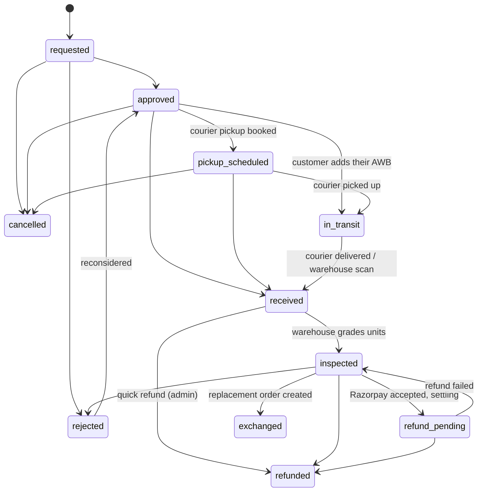

# Returns and exchanges

Last updated: 2026-11-05. Phase 4 of the logistics programme.

## Model

Each return or exchange is a record in `returns` (`ReturnDoc`). The order's
`returnRequest` mirrors the latest one, the same way `order.shipment` mirrors
its shipment, so screens and rules that read the order keep working. An
order may have several returns over time, but only one open at a time (a
partial unique index enforces this). Each return has its own code
(`RET-<order>-<n>`), and per-item:

- quantity;
- reason (`too_small`, `too_large`, `not_as_pictured`, `damaged`,
  `wrong_item`, `quality`, `changed_mind`, or `other` with a note);
- for an exchange, the variant wanted instead.

How it comes back is either a courier pickup or the customer shipping it
themselves (`self_ship`, recording their courier and AWB).

Returns written onto orders by older code (`order.returnRequest` without
`returnId`) are converted at startup, and again on demand by every route that
looks up an order's return. They get a deterministic id
(`ret_legacy_<order>`).

## Rules

- **Eligibility:** the order is delivered, not cancelled, not itself a
  replacement, inside the region's `returnWindowDays`, and has no return open.
- **Quantities:** at most what was bought, less what earlier returns took.
  Cancelled and rejected returns don't count.
- **Refund amount (`refundableAmount`):** each line's share of what was paid,
  `unitPrice x qty x (total - shipping) / itemSubtotal`, rounded down.
  Discounts are spread across lines and delivery charges aren't refunded.
  Refunds are capped at this amount. The existing order-level ceiling
  (never more than was paid in total) still applies.
- **Exchanges:** another variant of the same product, at the same price, in
  stock. Price differences aren't handled; return and reorder instead.
- **Stock:** returns to sellable only at warehouse inspection (unchanged
  from Phase 1). The ledger rows reference the return id.

## Lifecycle

- **Tracking:** courier scans on the reverse parcel (`shipment.returnId`)
  move the return. `picked_up` or `in_transit` moves it to in_transit, and
  `delivered` moves it to received. Every move goes through the state machine
  and is recorded in `status_events` (entity: the return id).
- **Cancelling:** customers can cancel until the parcel leaves. A booked
  courier pickup is cancelled with the courier first.
- **Refunds:** go through the existing Razorpay or manual refund path, with
  a credit note. A refund Razorpay settles later leaves the return
  `refund_pending` until `reconcileRefunds` or the webhook records it. A
  refused refund returns it to `inspected`, to be resolved again.
- **Exchanges:** create a new order in one transaction:
  - the chosen variants at the original unit prices, with nothing charged
    (the total is 0, shown as covered);
  - linked by `exchangeOf`;
  - stock taken and reserved at a warehouse like any order, then picked,
    packed and shipped normally.

  If the variant sold out meanwhile, it's refused and nothing changes; refund
  instead.
- **Order status:** once every unit of an order has come back and been
  settled, the original order reads `returned`.
- **Notifications:** customers get in-app notifications for requested,
  approved, pickup booked, received, refund started, refunded, exchange sent
  and rejected. Email, SMS and WhatsApp delivery comes with Phase 5.

## API

**Customer (`/store/customers/me`):**

| Endpoint | Purpose |
| --- | --- |
| `GET /orders/:id/return-options` | Returnable lines, refund per unit, exchange variants, reasons, window |
| `POST /returns` | `{ orderId, type, method, items[] }` |
| `GET /returns`, `GET /returns/:id` | Status history, reverse parcel and its scans, refund, replacement order, what the customer can do now |
| `POST /returns/:id/cancel` | Cancel before pickup |
| `POST /returns/:id/ship` | Add the courier and AWB (self ship) |
| `POST /orders/:id/returns` | The original endpoint, kept: one reason for the whole request, courier pickup |

**Admin (`/admin`):**

| Endpoint | Purpose |
| --- | --- |
| `GET /returns` | Filter by status or type, search by code or order number; counts by status |
| `GET /returns/:id` | History, shipment, refund, replacement order |
| `POST /returns/:id/{approve\|reject\|pickup\|receive\|refund\|exchange\|cancel}` | Owner only; audited; reject and cancel need a reason; refund takes an optional `amount` up to the refundable amount |
| `GET /return-options?orderNumber=` | For support filing a return |
| `POST /orders/:id/returns` | File a return on a customer's behalf (owner, audited) |
| `POST /orders/:id/return-request` | The order page's actions, kept; now acts on the order's open (else latest) return and adds `exchange`. `refund` with nothing received is a plain refund, as before. |

**Warehouse:** `GET /warehouse/returns/lookup` finds a return by reverse-pickup
AWB, the customer's own AWB, the return code or the order number.
`POST /warehouse/returns/:id/inspect` accepts a return id, or an order id for
that order's open return.

## Screens

- **Storefront, Account > Returns & Refunds:**
  - the eligible, in-progress and completed counts and lists are real;
  - each request shows its code, items and reasons, the size swap, the steps
    actually reached with dates, the pickup AWB with its latest scan and a
    tracking link (or a form for the customer's own AWB), the refund and its
    status, and the replacement order link;
  - customers can cancel while that's still allowed.

  The request dialog loads the order's options: per-item quantity and
  reason, refund or exchange (with the size to swap to), pickup or self
  ship, and a refund estimate.

  Removed: a hardcoded "Estimated pickup: tomorrow 10 AM-1 PM", a progress
  bar fixed at 35%, invented request ids, the order total shown as the
  refund, a stock photo fallback, and a fixed "14-day window".
- **Admin, Returns & exchanges:** rebuilt on `/admin/returns`:
  - counts by stage and tabs;
  - search;
  - CSV export of real records;
  - a side panel that offers only what the status allows (approve, book
    pickup, mark received, refund with an optional partial amount, send
    exchange, reject or cancel with a reason), with the full history;
  - "File a return" for support.

  Removed: invented return ids, order refs, HSN, size, colour and image, a
  "Bulk QC Pass" button that changed nothing, a manual-return form that made
  random ids and AWBs in browser memory, and QC grades that were never
  stored.
- **Warehouse app, Returns:** shows the return code, type and each item's
  reason, and inspects by return id.

## Tests

`apps/backend/test/returns-exchanges.test.ts` (15 tests, Razorpay and
Shiprocket stand-in):

- refund shares with a discount;
- exchange options (sold-out and dearer sizes excluded);
- partial and repeat returns;
- the one-open rule;
- self ship with lookup by the customer's AWB;
- inspection restock;
- refund cap and credit note;
- courier pickup moved by tracking webhooks;
- cancel before and after pickup;
- an exchange creating a zero-value replacement order allocated to the
  warehouse;
- an exchange refused when out of stock, then refunded instead;
- a refund that settles later;
- a refused refund;
- rejection with a reason;
- legacy migration;
- access by other customers;
- admin roles.

The existing returns, payments and fulfilment tests pass unchanged, apart
from one ledger assertion now keyed by the return id.

The storefront and admin screens were checked by hand in Chrome against a
throwaway API and database:

- **Storefront:** request an exchange, see it, add the AWB after approval;
  no axe violations.
- **Admin:** send an exchange, approve, a courier pickup refused without an
  integration, mark received, file for a customer. One axe finding comes from
  the shared, installed `Separator` component, unchanged by this work.

Doing this check exposed a bug, now fixed: the storefront returns page
crashed when a customer had no order left to return.

## Not done yet

- **Own-fleet reverse pickups:** returns are collected by courier or sent by
  the customer. Rider pickups would extend the Phase 3 delivery tasks.
- **Exchange price differences:** none (same-price exchanges only).
- **Customer bank details for refunds:** COD refunds are recorded as manual,
  as before; collecting the customer's bank or UPI details is a later step.
- **Customer photos:** a return request can't include photos yet.
